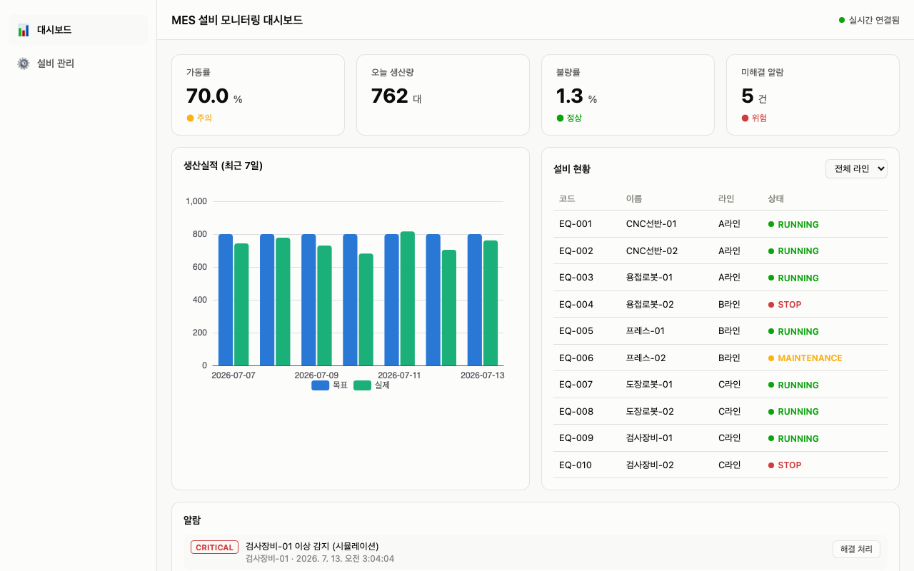
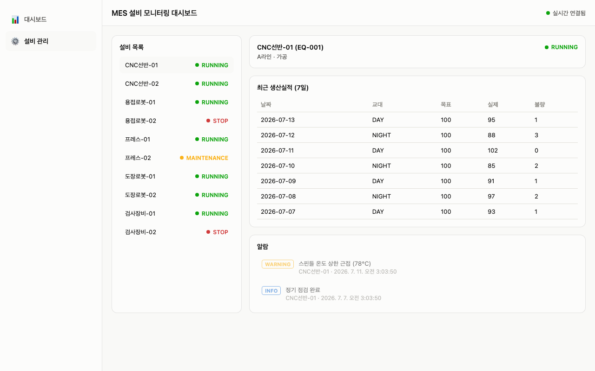
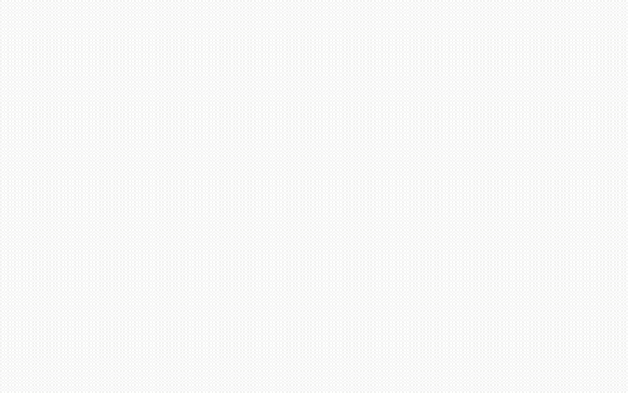

# MES 설비 모니터링 대시보드

공장 설비의 가동 현황, 생산실적, 알람을 한 화면에서 실시간으로 확인할 수 있는 모니터링 대시보드입니다. WebSocket을 통해 설비 상태 변화가 화면에 즉시 반영됩니다.

## 스크린샷

**대시보드**


**설비 관리 (마스터-디테일)**


**실시간 동작 (알람 해결 처리, 페이지 전환, 설비 선택)**


## 기술 스택

| 구분 | 기술 |
|---|---|
| Backend | Java 17, Spring Boot, Spring Data JPA, Spring WebSocket (STOMP) |
| Database | PostgreSQL |
| API 문서 | springdoc-openapi (Swagger UI) |
| Frontend | React 19, TypeScript, Vite |
| 시각화 | ECharts |
| 통신 | Axios (REST), SockJS + STOMP (WebSocket) |
| 배포 | Docker, Docker Compose |

## 주요 기능

- **실시간 설비 현황**: 설비 10대의 가동 상태(RUNNING/STOP/MAINTENANCE)를 라인별로 조회, WebSocket으로 상태 변경 즉시 반영
- **KPI 대시보드**: 가동률/생산량/불량률/미해결 알람 수를 임계값 기준 조건부 색상으로 표시
- **생산실적 시각화**: 최근 7일 목표 대비 실제 생산량을 ECharts 바차트로 표시
- **알람 관리**: 레벨(INFO/WARNING/CRITICAL)별 알람을 실시간 수신, 미해결 알람 우선 표시 및 해결 처리
- **설비 상세 조회**: 설비 선택 시 해당 설비의 최근 생산실적·알람 이력만 필터링해 조회
- **설비 상태 시뮬레이터**: `@Scheduled`로 7초마다 랜덤 설비 상태 변경 및 알람 발생 (실제 센서 데이터 대신 사용)

## 시스템 아키텍처

```
React (브라우저)
   │  REST API (Axios)
   │  WebSocket (SockJS + STOMP)
   ▼
Spring Boot
   ├── Controller → Service → Repository (레이어드 아키텍처)
   ├── WebSocketConfig (STOMP 메시지 브로커)
   └── EquipmentSimulator (@Scheduled 실시간 이벤트 발행)
   │
   ▼
PostgreSQL
```

도메인별 패키지 구조(`equipment/`, `production/`, `alarm/`)로 구성해, 필요 시 도메인 단위로 서비스를 분리(MSA 전환)할 수 있는 형태를 고려했습니다.

## API 명세

| Method | Endpoint | 설명 |
|---|---|---|
| GET | `/api/v1/equipment` | 설비 전체 목록 조회 |
| GET | `/api/v1/equipment/{id}` | 설비 상세 조회 |
| GET | `/api/v1/production` | 생산실적 조회 (날짜/라인 필터) |
| GET | `/api/v1/alarms` | 알람 목록 조회 (레벨/해결여부 필터) |
| PATCH | `/api/v1/alarms/{id}/resolve` | 알람 해결 처리 |
| GET | `/api/v1/dashboard/kpi` | KPI 요약 조회 |

전체 API는 백엔드 실행 후 `/swagger-ui/index.html`에서 확인 및 테스트할 수 있습니다.

## WebSocket 이벤트

| Topic | 설명 |
|---|---|
| `/topic/equipment-status` | 설비 상태 변경 시 발행 |
| `/topic/new-alarm` | 신규 알람 발생 시 발행 |

## 설계 의도

- **DTO 분리**: Entity를 API 응답에 직접 노출하지 않고 별도 DTO(record)로 변환해, 순환참조 방지 및 DB 스키마와 API 계약을 독립적으로 유지
- **공통 예외 처리**: `GlobalExceptionHandler`로 예외 종류별(리소스 없음/잘못된 요청/서버 오류) HTTP 상태 코드를 일관되게 매핑
- **환경변수 기반 설정**: Docker Compose 환경에서 DB 접속 정보를 `.env`로 분리, 민감 정보를 코드/이미지에 하드코딩하지 않음
- **레이어드 아키텍처**: Controller-Service-Repository로 관심사를 분리해 각 계층을 독립적으로 테스트/수정 가능하도록 구성

## 실행 방법

### Docker Compose (권장)

```bash
cp .env.example .env   # 환경변수 값 채우기
docker compose up --build -d
```

- 프론트엔드: http://localhost:3000
- 백엔드 API: http://localhost:8080
- Swagger UI: http://localhost:8080/swagger-ui/index.html

### 로컬 개발 환경

**백엔드**
```bash
# PostgreSQL이 로컬에 떠있어야 함 (mes 데이터베이스)
# 본인 Postgres 계정 정보와 다르면 환경변수로 덮어쓸 것
export SPRING_DATASOURCE_USERNAME=본인계정
export SPRING_DATASOURCE_PASSWORD=본인비밀번호
./gradlew bootRun
```

**프론트엔드**
```bash
cd frontend
nvm use   # Node 22 필요
npm install
npm run dev
```

## 프로젝트 배경

백엔드 개발 직무를 준비하며, 실시간 모니터링 시스템에서 자주 쓰이는 핵심 개념(REST API 설계, WebSocket 기반 실시간 통신, 도메인 모델링)을 직접 구현해보기 위해 만든 프로젝트입니다. 실제 설비 센서 데이터 대신 시뮬레이터로 이벤트를 발생시켰지만, WebSocket을 통해 상태 변화를 실시간으로 전달하는 통신 구조 자체는 동일한 방식으로 구현했습니다.
